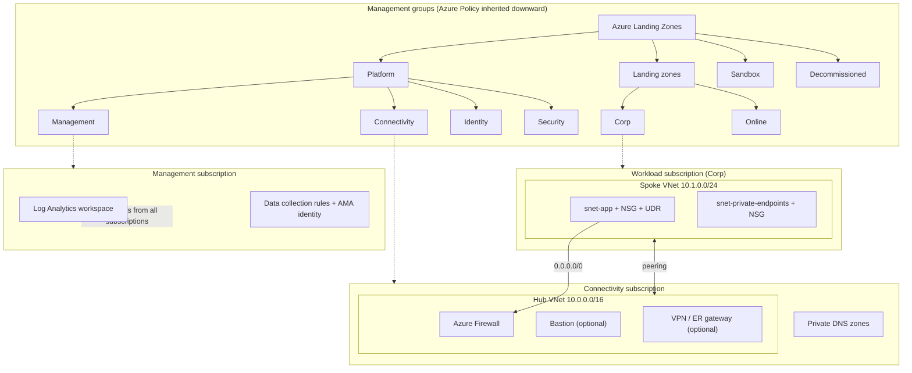

# Azure Landing Zone (Terraform)

An end-to-end Azure platform landing zone, deployed from GitHub Actions with Terraform. It follows Microsoft's [Cloud Adoption Framework landing zone architecture](https://learn.microsoft.com/azure/cloud-adoption-framework/ready/landing-zone/) and is built on [Azure Verified Modules](https://azure.github.io/Azure-Verified-Modules/), the modules Microsoft now recommends for ALZ in place of the retired `caf-enterprise-scale` module.

The repository deploys:

| Area | What gets deployed |
|---|---|
| **Governance** | The ALZ management group hierarchy, more than 120 Azure Policy assignments from the ALZ library (security baselines, diagnostics, Defender for Cloud, allowed resource rules), and the ALZ custom RBAC roles |
| **Management** | A central Log Analytics workspace, Azure Monitor Agent managed identity, and data collection rules for VM Insights, Change Tracking and Defender for SQL. Microsoft Sentinel is optional |
| **Connectivity** | A hub VNet with Azure Firewall and firewall policy, and private DNS zones for Private Link. Bastion, VPN or ExpressRoute gateways, DNS Private Resolver and DDoS Network Protection are optional |
| **Application landing zone** | A subscription moved into **Corp** using the ALZ subscription vending pattern. It has a spoke VNet peered to the hub, a default route through the firewall, NSGs on every subnet, RBAC for the app team, and an optional budget |
| **Delivery** | GitHub Actions: lint and security scan on every PR, `terraform plan` posted to the PR, and `apply` gated by an environment approval. Sign-in uses OIDC (no stored secrets). A manual destroy workflow is included |

## Architecture



More detail: [docs/architecture.md](docs/architecture.md). The reasons behind each choice: [docs/design-decisions.md](docs/design-decisions.md).

## Repository layout

```
.
├── bootstrap/                 One-time setup: state storage + GitHub OIDC identity
│   └── bootstrap.sh
├── infra/                     The landing zone (one Terraform root module)
│   ├── main.governance.tf     Management groups, policy, RBAC      (avm-ptn-alz)
│   ├── main.management.tf     Logging and monitoring               (avm-ptn-alz-management)
│   ├── main.connectivity.tf   Hub network, firewall, DNS           (avm-ptn-alz-connectivity-hub-and-spoke-vnet)
│   ├── main.landing_zones.tf  Application landing zone             (avm-ptn-alz-sub-vending)
│   ├── locals.tf              Naming, policy parameters, subscription placement
│   ├── variables.tf / outputs.tf / providers.tf / terraform.tf
│   └── landing-zone.tfvars    Committed, non-sensitive settings
├── docs/
└── .github/workflows/         ci.yml, deploy.yml, destroy.yml
```

## Prerequisites

- An Entra ID tenant where you can assign roles at the **Tenant Root Group**. This means Owner there, or Global Administrator with [elevated access](https://learn.microsoft.com/azure/role-based-access-control/elevate-access-global-admin).
- Two or three subscriptions: management, connectivity and (optionally) workload. For a low-cost lab you can reuse one subscription for several roles. See `subscription_ids` in [variables.tf](infra/variables.tf).
- Azure CLI 2.60 or newer. For local runs, also Terraform 1.12 or newer.

> Use a test tenant. This creates management groups at the top of the tenant and assigns policies that **deny** some resource configurations, such as public IPs on NICs in Corp and subnets without NSGs. Don't point it at a tenant with existing workloads until you've reviewed the policies.

## Deploy

**1. Bootstrap (once).** In Azure Cloud Shell:

```bash
./bootstrap/bootstrap.sh <github-owner>/<repo-name> <management-sub-id> <connectivity-sub-id> <workload-sub-id>
```

This creates the remote state storage account and an app registration with federated credentials for this repo, and grants it its roles. It then prints the repository variables to set.

**2. Set repository variables** in *Settings → Secrets and variables → Actions → Variables*:

| Variable | Example |
|---|---|
| `AZURE_CLIENT_ID`, `AZURE_TENANT_ID`, `AZURE_SUBSCRIPTION_ID` | printed by bootstrap |
| `TF_STATE_RESOURCE_GROUP`, `TF_STATE_STORAGE_ACCOUNT`, `TF_STATE_CONTAINER`, `TF_STATE_KEY` | printed by bootstrap |
| `SUBSCRIPTION_IDS` | `{"management":"…","connectivity":"…","workload":"…"}` |
| `SECURITY_CONTACT_EMAIL` | `you@example.com` |

**3. Create the `production` environment** (*Settings → Environments*) and add yourself as a required reviewer.

**4. Open a pull request** that changes anything under `infra/`. The plan is posted as a comment. Merge it, approve the deployment, and the apply runs. The first apply takes about 30–45 minutes, mostly for the firewall and the policy role assignments.

### Running locally

```bash
cd infra
cp backend.hcl.example backend.hcl                    # fill in from bootstrap output
cp local.auto.tfvars.example local.auto.tfvars        # subscription IDs + email
az login
terraform init -backend-config=backend.hcl
terraform plan -var-file=landing-zone.tfvars
```

After the first successful `init`, commit `infra/.terraform.lock.hcl` so every run uses the same provider versions.

## Cost

Approximate pay-as-you-go prices for US regions. Check the [Azure pricing calculator](https://azure.microsoft.com/pricing/calculator/) for current figures in your region.

| Component | Default | Approx. monthly cost |
|---|---|---|
| Azure Firewall Basic | **on** | ~$290 plus data processed |
| Azure Firewall Standard / Premium | off | ~$900 / ~$1,300 |
| Log Analytics | **on** | pay per GB ingested (small for a lab) |
| Private DNS zones | **on** | ~$0.50 per zone; the full Private Link set is a few dozen zones |
| Azure Bastion | off | ~$140 (Basic) |
| VPN gateway | off | ~$140–$300 |
| DNS Private Resolver | off | ~$180 per endpoint |
| **DDoS Network Protection** | off | **~$2,900** |
| Defender for Cloud plans | per policy defaults | per protected resource |

With the defaults, expect roughly **$350 a month** while it's running. Run the **Destroy landing zone** workflow when you're done.

## Teardown

Run *Actions → Destroy landing zone → Run workflow* and type `destroy` to confirm. Policies may have deployed resources outside Terraform's state, such as Defender export or Service Health alert resource groups. Delete those by hand if they remain. Platform subscriptions are moved back to the tenant's default management group, which is normally the Tenant Root Group.

## Roadmap

- Multi-region hub (a second `hub_virtual_networks` entry) with hub-to-hub peering
- Custom least-privilege roles for the pipeline identity instead of Owner at the root
- `terraform test` suites and a nightly drift-detection plan
- Azure Monitor Baseline Alerts (AMBA) policy set

## References

- [Azure Landing Zones documentation (Terraform)](https://azure.github.io/Azure-Landing-Zones/terraform/)
- [Azure Verified Modules: Terraform pattern modules](https://azure.github.io/Azure-Verified-Modules/indexes/terraform/tf-pattern-modules/)
- [Azure Landing Zones Library](https://azure.github.io/Azure-Landing-Zones-Library/)
